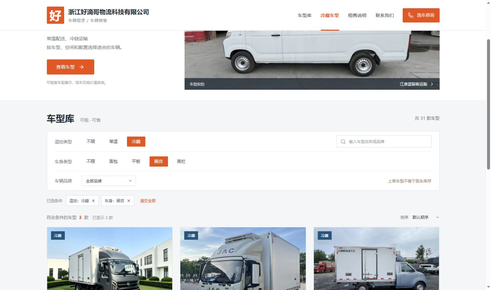

# 浙江好滴哥物流科技有限公司 车型租售网站

已从 32 份原始 Word 资料整理 31 款车型，合并东风六方车的重复资料。网站显示可租售车型，现车情况独立维护；初始全部标记为“现车待确认”，电话和微信留空。

## 界面预览

[在线查看车型展示预览](https://rux-bot.github.io/haodigecar/)



仓库包含网站源码、初始车型资料和对应图片。运营数据库、管理员账号与会话、后台上传目录、私有部署包和环境配置均不会上传。下载源码后首次运行会创建独立数据库，需要重新设置管理员；这不会影响原电脑已有的网站数据。

在线预览提供车型浏览、筛选、详情图片和咨询内容复制，展示仓库中已经审核的初始车型资料；预览不连接本机数据库，也不提供管理后台。本机后台的改动不会自动同步到预览。完整网站需要 Node.js 服务，不能直接双击 `index.html` 或只上传 `dist/` 到静态网页空间。Windows 的打开方法见下文。

预览由 GitHub Pages 从 `main` 分支自动构建发布，只有检查通过后才更新页面。也可执行 `npm run build:preview`，生成独立的 `dist-preview/` 目录。该步骤只使用仓库里的车型种子和图片，不读取运营数据库或上传目录。

## 打开网站

需要 Node.js 24.15 或更高版本。Windows 下双击 `启动网站.cmd`：脚本会检查已有服务，必要时安装依赖和构建，然后独立启动隐藏的后台进程并打开浏览器。启动窗口可以关闭，网站仍会继续运行。

- 网站：<http://127.0.0.1:3001>
- 管理后台：<http://127.0.0.1:3001/admin>

第一次进入后台时，自行创建管理员账号和至少 12 位、包含字母及数字的密码。没有预设公开密码。重复双击启动脚本会复用本项目的健康后台进程；端口被其他程序或旧启动方式占用时会提示，不会结束无关进程。

停止网站请双击 `停止网站.cmd`。它只会停止启动记录中的 PID，并核对完整项目入口和进程创建时间，防止 PID 被其他程序复用时误停。电脑重启后需再次双击启动；本脚本没有注册开机自启或 Windows 系统服务。日志和进程记录位于已忽略的 `qa/runtime/`。源码更新后，先停止再启动，会按需重新构建。

查看状态可运行 `powershell -NoProfile -ExecutionPolicy Bypass -File scripts/local-service.ps1 -Action Status`。本机脚本固定使用 `127.0.0.1:3001` 和本机 HTTP 设置，仅用于本机运行；公网服务请使用下方正式部署方案。

也可以从本文件所在目录以前台方式运行；这种方式需要保持终端打开：

```powershell
npm ci
npm run build
npm start
```

开发模式运行 `npm run dev`，前端位于 5173 端口，API 位于 3001 端口。启动另一模式前先停止已有进程，避免端口冲突。

## 日常操作

在后台“车型管理”里，可以搜索车型，点击“上架 / 下架”调整网站是否展示。车型“编辑”可修改名称、品牌、常温或冷藏、车身类型、车辆参数、现车状态和图片。支持新增车型；新车型默认下架，编辑确认后再上架。

图片支持 JPG、PNG、WebP，每张最多 8 MB；第一张为封面，可上传、移除或调整顺序。保存移除或替换后，服务器会删除已没有任何车型或公司图标引用的旧文件；仍被其他车型引用的图片会保留。

在“网站设置”里填写联系电话、微信和联系地址。前台会启用电话拨打与微信复制。未填写联系方式时，咨询弹窗会明确说明，并可复制咨询内容，不会生成虚假联系方式或假装提交了线索。

公司图标也在“网站设置”中维护：点击“上传图标”或“更换图标”，选择 PNG / JPG / WebP（不超过 8 MB），检查预览后点击“保存网站设置”。保存后同步到前台页头、页脚及浏览器图标。可点击“移除图标”后保存，恢复文字标识。原有车型和联系方式不受图标更新影响。

前台支持温控、车身、品牌和搜索词组合筛选，支持名称排序和有现车优先；车型详情有图片轮播、参数及咨询入口。筛选条件保存在网址中，便于转发。手机和电脑均可使用。

## 数据来源

- 车型种子：`data/vehicles.json`。仅首次启动时导入，之后运营修改以 SQLite 数据库为准；重新启动不会覆盖修改。
- 持久化数据库：`data/catalog.sqlite`，同时可能有 `-wal` / `-shm` 文件。
- 当前保留的导入图片：`public/vehicles/`；后台上传图片：`public/uploads/`。两处都是运营媒体，需要一起持久化和备份。
- 核对记录与待确认信息：`docs/CATALOG-NOTES.md`。
- GitHub 调研及选型：`docs/framework-research.md`。

当前资料有 24 款常温、7 款冷藏；车身为 22 款面包、5 款厢货、4 款平板，没有明确高栏车型。高栏筛选保留完整空态，后续可在后台新增或调整。

资料中冲突或缺单位的参数没有自行补造；部分容积留空，部分尺寸明确标注待确认。图片来自用户提供的 Word 文档，实际车辆外观和配置以业务确认结果为准。

## 技术与验证

React 19 + TypeScript + Vite 8，Express 5 API，Node 内置 SQLite。没有依赖外部数据库或付费 SaaS。后台使用密码哈希、HttpOnly 会话、来源检查和 CSRF 校验。

```powershell
npm test
npm run build
```

测试用独立临时数据库，不修改运营数据，覆盖登录、权限、上下架、数据持久化、上传和参数验证。

## 正式部署

完整网站需部署到支持 Node.js 和持久化磁盘的服务器。无需上传整个原始车型文件夹，在项目目录执行：

```powershell
npm run package:deploy
```

脚本先构建，再生成 `deployment/<时间戳-编号>/vehicle-site/`。仅带运行代码、依赖清单、数据库一致性备份和全部车型（含下架）及公司图标当前引用的图片。不会带入 Word、图片归档、测试、源代码或 `node_modules`。每次输出独立目录，不覆盖历史包；数据库副本清空旧会话，原库不修改。没有数据库时才携带车型种子，供全新初始化。

将精简目录上传后，用 Node.js 24.15+ 执行 `npm ci --omit=dev`，再运行 `node server/index.mjs`。先在本机完成管理员初始化，再启用生产环境、HTTPS、实际 `PUBLIC_ORIGIN` 和安全 Cookie。需要持续保存 `data/`、`public/vehicles/`、`public/uploads/`；导入原图也属于可维护的运营数据。部署包可能含管理员密码哈希和业务数据，请勿公开上传。

完整操作及 Docker、备份、迁移说明见 [docs/DEPLOYMENT.md](docs/DEPLOYMENT.md)。
